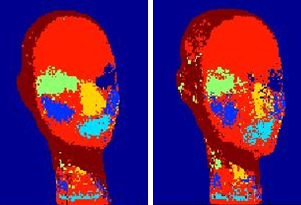

# Face Depth Estimation from a Single Color Image

  

A random decision forest trained on paired color and depth images of a painted mannequin face to recognize facial regions.

Students: Tova Krakauer.

Supervision: Aaron Wetzler.

## Status

**Partial MATLAB research source recovered.** The three original files are in [`source/original/`](source/original/): `Test2nd.m`, `buildDiff.m` and `getDiff.m`. They are research snapshots rather than a complete final application, trained model or dataset.

## Running

The files use MATLAB image-processing, camera-calibration and random-forest routines (`TreeBagger`/`predict`). Referenced calibration, classifier, feature, image and depth files are absent. No MATLAB/Octave run or successful end-to-end build is claimed. Supply appropriately licensed data and review all paths and file outputs before attempting these historical scripts.

## Original code

All three published MATLAB files preserve the recovered attachment bytes. Raw correspondence, generic face-image archives and unrelated/unverified datasets were not published.

The [source provenance manifest](source/PROVENANCE.json) records the published paths, hashes and any redactions. Original student/third-party notices remain in place. No blanket license is assigned to recovered work. Future ports belong in `updated/` and must be described and tested as updated implementations.

## Updated component and notebook

Feature assembly from Tova Krakauer's recovered MATLAB research source. The reviewed Python update is in [updated/](updated/); it preserves the historical source above and documents deliberate behavior changes. This component is not the complete application.

[Run the notebook](updated/notebooks/depth-features.ipynb) · [Open in Colab](https://colab.research.google.com/github/twerdster/face-depth-estimation-from-a-single-color-image/blob/main/updated/notebooks/depth-features.ipynb)

Validation: 18 unit tests and an executed Jupyter notebook on macOS/Python 3.14. No original MATLAB runtime was available. See [the execution record](updated/VALIDATION.json). The helper was drafted with Claude Code and completed/reviewed with Codex for Aaron Wetzler.

## Links

- [Project entry on Aaron Wetzler's website](https://twerdster.github.io/#face-depth-estimation-from-a-single-color-image)

## Attribution and Updates

Original student and third-party attribution will be retained. No new license for original source code is implied by this README. Original authors can open an issue to contribute updates or request corrections or removal of their material.

